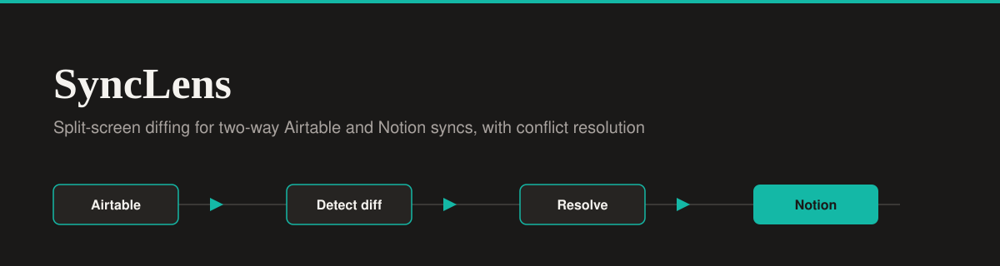

<div align="center">




</div>

# SyncLens - Airtable and Notion Sync Monitor

A premium, B2B-grade monitoring dashboard that acts as the UI layer for an n8n two-way sync pipeline between Airtable and Notion. This app visualizes the logic of **Workflow 4 (Airtable and Notion Two-Way Sync)** by surfacing conflicts and letting the user resolve them.

**Live Demo:** [airtable-notion-diff.lovable.app](https://airtable-notion-diff.lovable.app)

## The Problem

Two-way syncs are notorious for silent data drift. When two team members edit the same record on different platforms, generic dashboards just show a "Failed" status. They do not explain why it failed or how to fix it.

## The Solution: Split-Screen Diffing

Instead of a standard data table, SyncLens features a custom split-screen diff viewer inspired by GitHub's code review interface.

- Conflicting fields are highlighted in solid yellow on both sides.
- The UI surfaces the timestamps (for example `Last Modified: 08:42` vs `08:47`) to explain the 2-second tolerance rule that triggered the conflict.
- The resolution action bar lets the user Keep Airtable, Keep Notion, or Merge Manually, and instantly updates the React state to resolve the conflict.

## n8n Workflow Reference

This UI is designed to accompany a self-hosted n8n automation. You can view the actual backend workflow code and documentation in my platform integration portfolio:

- **Repository:** [platform-integration-portfolio](https://github.com/Xhenzouu/platform-integration-portfolio)
- **Workflow Documentation:** [Workflow 4: Airtable and Notion Two-Way Sync](https://github.com/Xhenzouu/platform-integration-portfolio/blob/main/docs/workflows/04-airtable-notion-two-way-sync.md)
- **Raw Workflow JSON:** [airtable-notion-two-way-sync.json](https://github.com/Xhenzouu/platform-integration-portfolio/blob/main/workflows/airtable-notion-two-way-sync.json)

The n8n workflow handles the following logic:

1. Runs on a schedule and reads both Airtable and Notion.
2. Detects changes on both platforms using per-record sync state.
3. Surfaces conflicts for review when the same record changed on both sides.
4. Records every run and every failure in a Supabase audit table.

This dashboard visualizes that flow: the KPI header and run history reflect the sync runs, and the diff viewer shows how a conflicting record would be reviewed and resolved.

## Features

- **Split-Screen Diff Viewer:** Side-by-side Airtable and Notion versions of a record with conflicting fields highlighted.
- **Interactive Resolution:** Resolving a conflict drops the KPI count and changes the status pill in real time.
- **KPI Header:** Instant visibility into Last Synced timestamp, Total Conflicts, and Orphaned Records.
- **Run History:** A secondary table view to track event logs (Created, Updated, Skipped).
- **Dual Themes:** Light and Dark mode built with Tailwind's `dark:` classes.
- **Collapsible Sidebar:** A custom vertical-stacking layout for the logo and chevron when collapsed.
- **Local State Only:** Pure React state (`useState`) seeded with realistic mock data, with no backend calls.
- **Editorial Typography:** Serif headers (Georgia) paired with sans-serif data text (Inter).

## Run Locally

1. Clone the repo:

   ```bash
   git clone https://github.com/Xhenzouu/airtable-notion-diff.git
   cd airtable-notion-diff
   ```

2. Install dependencies:

   ```bash
   npm install
   ```

3. Start the development server:

   ```bash
   npm run dev
   ```
